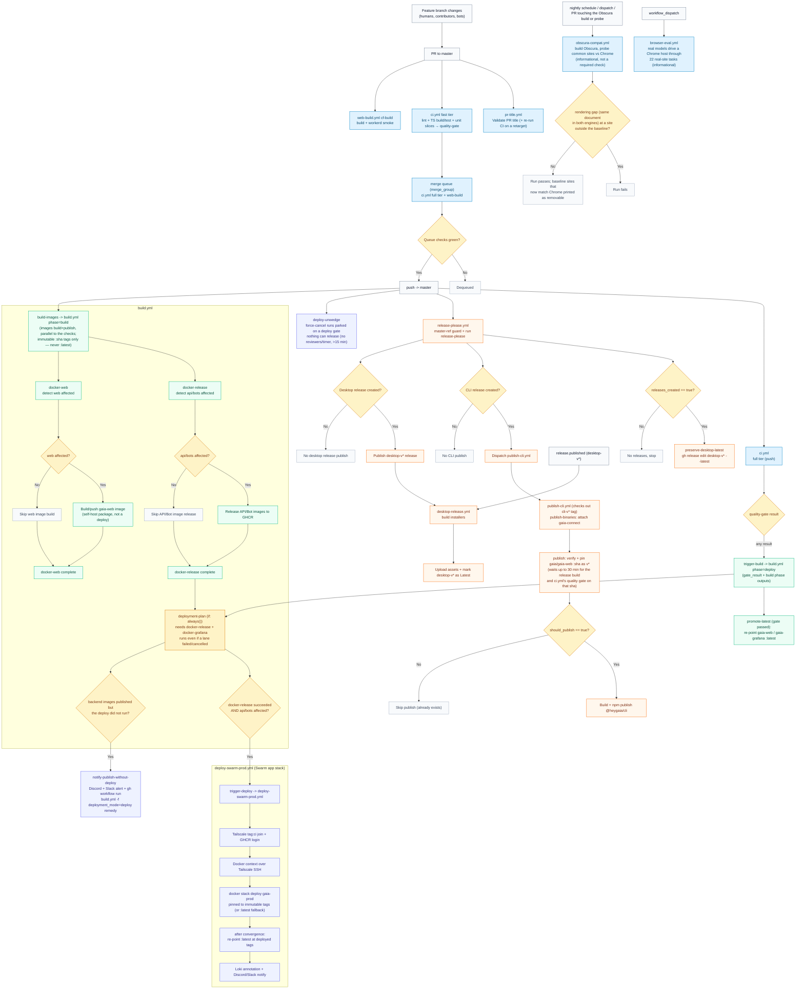

# CI and Deployment Flow

> IMPORTANT FOR AGENTS: If any workflow trigger, job dependency, deploy condition, workflow dispatch wiring, or release path changes in `.github/workflows/`, update this file in the same PR.

## End-to-End Flow Diagram

## Per-Workflow Steps
### `.github/workflows/ci.yml` ("CI")
0. THE pipeline, for `pull_request` (any base — no `branches:` filter, so stacked PRs are gated), `merge_group`, pushes to `master`, and `workflow_dispatch` (which additionally enables the `probe` job and the `force_home` / `force_github` / `runner_label` / `cpu_tokens` inputs). `pull_request` uses the default types only: a run on `edited` created every job's row and a title/body edit turned the commit's real rows into "Skipped". A retarget re-runs the head's CI run from `pr-title.yml` (`runner.py rescope`). Concurrency is per SHA — group `ci-<ref>-<sha>` with `cancel-in-progress: true` — so a new push never waits on the old run's cancellation; superseded runs of the branch are cancelled through the API by `scripts/ci/runner.py cancel-superseded` in `select-runner`.
1. `select-runner` (control-plane runner) runs `scripts/ci/runner.py select` once and publishes three pools: `light` (detect, lint, scans), `heavy` (ts-build-test, unit slices, the image) and `services` (the slices and mutation shards that need the test-services namespace). Each pool runs GitHub-hosted first, overflows to `gaia-home` (when it has an idle listener for every job of the pool) once GitHub's hosted queue is saturated, and to `CI_BLACKSMITH_LABEL` when the box has no idle listener either (`.github/CLAUDE.md`). Fork PRs, untrusted authors and bots always get GitHub-hosted runners. `runner-watchdog` (GitHub-hosted, not in the gate) re-dispatches a run whose self-hosted jobs stay queued past 8 minutes on GitHub-hosted runners (a merge-group run is handed to `ci-requeue.yml` instead, which force-cancels and re-runs it in full: a plain cancel would run `quality-gate` red and drop the group from the queue); `ci-requeue.yml` sweeps re-run attempts stranded the same way.
2. `detect` (one checkout, one `nx-set-shas`, one install) decides everything the run checks: the `tier` (`fast` on a PR push, `full` otherwise), the base every lane diffs against (`changes.sh base`: the PR's real parent from the API, or `merge_group.base_sha`), the Nx-affected project lists and the path-scoped signals (`has_api_schema`, `has_analytics`, `has_alert_rules`, `has_go`, `has_js_sources`), the test-python matrices cut to the tier (`pytest.sh slices` with `CI_TIER`), the reuse plan (`verdict.py reuse-plan`, PR pushes only) and the mutation plan (`mutation.py plan`, both tiers, last, because it is also the step that fails when changed app code has no test file).
3. Fast tier (every PR push):
   - `lint-node` — biome, deps (syncpack + manypkg + package.json lint), circular, file-size, types-location, doc-comments, components-per-file, package-hygiene (publint + attw), pnpm-audit, type-check, and duplicates (jscpd, started in the background first and joined at the end).
   - `lint-python` — ruff, custom-lints, lint-imports, ignore-whys, plr-complexity, typed-boundaries, xenon, interrogate, bandit, mypy, suppression-hygiene, ignore-staleness, tool-pins, alert-rules (pint + promtool).
   - `lint-mixed` — api-schema, analytics-catalog, cli-config-schema, deploy-templates (also path-scoped on the self-host compose, Caddyfile and machine secrets), api-schema-types, the observability checks (scanner tests, full map, PR ratchet, bots surface), wide-event-conformance, dead-code (knip + vulture), harness-tests (`tools/lints`, `tools/llm-stub`, `scripts/ci`, `scripts/dev`), go-connect (path-scoped), gitleaks (not on a merge group, which the action does not support — the queued commits are the PR's), and analytics-check (path-scoped; a push to master first syncs the live PostHog actions and loop alert, anything else is held to master's catalog and actions.json; skipped for forks and Dependabot, which get no secrets).
   - `ts-build-test` — the nx build and the vitest run, both under `runner.py with-slots`.
   - `test-python` — the `unit-a` and `unit-b` slices, test-impact-selected on a PR.
   - `test-mutation` — one `mutation (<module>)` shard per changed module (`max-parallel: 6`, every planned shard at once), so a survivor surfaces on the PR instead of ejecting the merge group.
   Each check in a grouped job is its own `continue-on-error` step, posted as a `ci / <area> / <check>` commit status (`verdict.py post-statuses`, areas `node` / `python` / `contracts` / `tests` / `security` / `build` from `CHECK_AREAS`; fork and Dependabot PRs skip posting) and folded into the job's verdict by `verdict.py step-outcomes`. A check whose last pass on the PR still holds is skipped by the reuse plan.
4. Full tier (merge_group, master push, dispatch) adds: the `integration` and `bridge` slices (services pool; regression-proof — the change's new `@pytest.mark.regression` tests must FAIL on its base — rides the integration slice), `test-python-engines` (the `browser` slice, after `obscura-bin` builds Obscura under a 60-minute cap), `python-audit` (import-cost trend + pip-audit), `scan` (semgrep + trivy, advisory: `exit-code: "0"` until `chore/trivy-npm-audit` lands), and `docker-image` (times an api image build; in the merge queue only when the image inputs changed). On a PR push and in the merge queue the audits fail only on an advisory in a version the change put in the lockfile; master fails on any (`audit.sh`, `AUDIT_SCOPE`). Coverage is traced only on master/dispatch, and `coverage` combines the five slices there and enforces `fail_under` 80.
5. `quality-gate` (the required check, also the merge queue's) runs `if: always()`, never waits, and consolidates every lane's verdict (`verdict.py consolidate`); skipped lanes pass, a lane that ran and reported nothing fails. It needs `select-runner`, `detect`, `probe`, `lint-node`, `lint-python`, `lint-mixed`, `python-audit`, `ts-build-test`, `scan`, `obscura-bin`, `test-python`, `test-python-engines`, `coverage`, `docker-image`, `test-mutation`. `changelog-sync` (auto-opens a fix PR; not on a merge group) is deliberately excluded. `Validate PR Title`, the other required check, lives in `pr-title.yml`.
6. On `master` pushes only, `build.yml` is called in two phases: `build-images` (`phase=build`, needs only `detect`) builds and publishes the Docker images in parallel with the checks — immutable `:<sha>`/version tags only, never `:latest`; then `trigger-build` (`phase=deploy`, needs `quality-gate` + `build-images`, `if: always()` so a failed gate still reaches the orphan guardrail) runs the deploy plan, `:latest` promotion and the Swarm deploy.
7. Also on `master` pushes only, `deploy-unwedge` (GitHub-hosted, no `needs`, not in the gate) runs `scripts/ci/deploy.sh unwedge`: it force-cancels any other master run parked in `waiting` on a deployment gate that has no reviewers and no wait timer for longer than 15 minutes, then sends a Discord + Slack alert.

### `.github/workflows/build.yml`
0. Phase-aware entrypoints: called from ci.yml as `phase=build` (image lanes only, pre-gate, immutable tags only) and `phase=deploy` (deploy plan + `:latest` promotion + Swarm deploy, fed by the build phase's outputs passed back as inputs). Manual `workflow_dispatch` / `repository_dispatch` leave `phase` empty and run the legacy single-phase flow unchanged. No job may move `:latest` in `phase=build` — the quality gate has not reported yet.
1. Start three build lanes: `docker-release`, `docker-web`, `docker-grafana` (skipped in `phase=deploy`).
2. `docker-release`: detect affected backend/bot projects (plus `release.sh cli-release-images`: a commit that bumps `packages/cli`'s version also builds the `gaia`, `gaia-web` and bot images, via the `api_image` / `web_image` / `bots_image` outputs, because its CLI publish pins that commit's `:<sha>` set (for the three self-host bots, `docker-bots-arm64` builds their arm64 half on a native runner and `docker-bots-manifest` tags `:<sha>` as an amd64 + arm64 index of the release's bot images; neither is on the deploy path); deploys still key on `api`/`web`/`bots`, so a CLI-only release never redeploys the backend), publish images to GHCR, optionally sync Discord commands. Records `images_published` right after its push steps (before Discord command sync), so a later, unrelated step failure never misreports a real publish as "nothing published". After the release steps, `scripts/ci/release.sh resolve-image-tags` resolves the immutable per-commit tags nx pushed (production versionScheme `YYMM.DD.<shortsha>`, read from the local image store, never recomputed) and guarantees they exist in GHCR (pushing them if nx skipped publishing), emitting `apps_tag` (gaia + gaia-voice-agent) and `bots_tag` (the five bot images) — empty when that group wasn't released this run. Backend `:latest` is never pushed at build time: it is re-pointed exclusively by the deploy's ``deploy.sh retag`` after convergence (":latest == deployed").
3. `docker-web`: detect `web` changes and build/push the `gaia-web` image only when affected. This is a package publish for self-host users (`docker-compose.selfhost.yml`), not a production deploy — the hosted frontend deploys via `.github/workflows/deploy-web.yml` → Cloudflare Workers (`wrangler deploy`) on every master push. In `phase=build` it pushes only `:<sha>`; `promote-latest` re-points `:latest` after the gate passes. Layer cache lives in GHCR (`gaia-web:buildcache`, zstd) — the `type=gha` export measured 449s of a 951s build.
4. `docker-grafana`: builds/pushes the Grafana image unconditionally every run (tiny COPY layer over the upstream image). Not part of orphan detection — it has no "affected" concept. Same `:latest` rule: `:<sha>` only in `phase=build`; `:latest` moves via the deploy retag or `promote-latest`.
5. `deployment-plan` runs with `if: always()` — it is never skipped by a lane failing or being cancelled — and needs `docker-release` + `docker-grafana` purely for sequencing (deploy planning must not race ahead of the build lanes). It evaluates `docker-release`'s `.result` plus backend affected-detection (`docker-release.outputs.api_affected`/`bots_affected`) via `scripts/ci/deploy.sh plan`:
   - `backend_deploy` is `true` only when `docker-release` succeeded AND api/bots affected. A failed/cancelled `docker-release` never deploys; `docker-web`'s result never gates it — the hosted frontend has already shipped itself either way.
   - `backend_orphaned` flags when backend images actually published to GHCR (`images_published` — publish evidence, not the job result) but the deploy did not run this time (lane failure, cancellation, or the plan deciding not to deploy). Scoped to `master` only, and a deploy the operator deliberately excluded via `deployment_mode=none` is never flagged — an operator choice is not drift.
   - Manual `workflow_dispatch` mode `deploy` bypasses affected-detection AND lane-result gating — the intended one-command remedy for drift: `gh workflow run build.yml --ref master -f deployment_mode=deploy` redeploys whatever is currently tagged `:latest` in GHCR regardless of what this run's own build lanes did. Manual `auto` behaves like an automatic push.
6. `notify-publish-without-deploy` fires an alert when `backend_orphaned` is set, naming the published-but-undeployed images and the `gh workflow run` remedy above. All deploy-pipeline sends go through `scripts/ci/deploy.sh notify`, which posts one message to Discord (`DISCORD_WEBHOOK`, with `wait=true` so the log records the delivered message and channel) and to Slack (`SLACK_WEBHOOK`, the same incoming webhook Grafana alerts post to) and appends the run link; a missing or rejected webhook fails the step after both were attempted. Send steps keep `continue-on-error` on the send step only — the message is fully logged in the run either way, and a dropped webhook must not turn an otherwise-green run red.
7. Trigger `deploy-swarm-prod.yml` when `backend_deploy` is true. `trigger-deploy` passes the immutable tags through (`apps_image_tag` / `bots_image_tag` from `docker-release`, `grafana_image_tag` = the commit sha when `docker-grafana` succeeded); empty tags mean the deploy falls back to `:latest` (the manual-mode drift remedy keeps exactly its old semantics).
8. `promote-latest` (`phase=deploy`, gate passed): `scripts/ci/release.sh promote-latest` re-points `:latest` for the two repos the Swarm deploy does not own — `gaia-web` (package publish) and `gaia-grafana` when no backend deploy runs to retag it — via registry-side `imagetools create`. Backend repos are deliberately absent (deploy retag owns them).

### `.github/workflows/deploy-swarm-prod.yml`
1. Join the tailnet as an ephemeral `tag:ci` node and open a Docker context to the VM over Tailscale SSH via the `setup-swarm-context` composite action (no SSH key secret), then log in to GHCR.
2. Run `docker --context prod stack deploy --with-registry-auth` for the app stack (`gaia-prod`), exporting the `apps_image_tag` / `bots_image_tag` / `grafana_image_tag` inputs as `GAIA_IMAGE_TAG` / `GAIA_BOTS_IMAGE_TAG` / `GAIA_GRAFANA_IMAGE_TAG` so the stack is pinned to the exact images this run verified. Empty inputs fall through to the compose file's `${VAR:-latest}` defaults — the pre-parameterization behavior, used by manual dispatches that just want to redeploy `:latest`.
   Swarm handles rolling update; the workflow polls `gaia-backend`, `arq_worker`, `embedding-sidecar`, `voice-agent-worker` (plus the bots and grafana when their tags were passed) for convergence and fails on auto-rollback. Before the deploy, `deploy.sh served-commit` records the commit prod's `/health` reports; after convergence, `deploy.sh verify-commit` reads `GIT_COMMIT_SHA` from the deployed image's config and fails unless `https://api.heygaia.io/health` (and each `/bots/<name>/health` when bots were deployed) serves it five reads in a row.
3. Only after convergence succeeds, `scripts/ci/deploy.sh retag` re-points each deployed repo's `:latest` at the deployed tag registry-side (`docker buildx imagetools create`, no layer transfer) — `:latest` is a deploy-time alias meaning "what prod runs", not "what was last built". A failed deploy does not move `:latest`.
4. Push a deploy annotation to Loki (including the deployed tags) and send status to Discord and Slack via `scripts/ci/deploy.sh notify`. Success carries the verified commit, the converged services and the commit subjects since the previous prod commit (`deploy.sh changelog`). `action=notify-test` sends one test message through the same path without deploying.
5. The runner reaches the VM over Tailscale SSH (`setup-swarm-context` joins as an ephemeral `tag:ci` node and logs in by tailnet identity — no SSH key secret; the Hetzner firewall has no public SSH rule). Manual `workflow_dispatch` supports `action=verify`: same private checkout and prod context, but `docker stack config` renders the stack instead of deploying it — run it after touching the infra repo, the deploy key, or the tailnet path. It also supports `action=rollback` with `rollback_mode=last` (Docker service rollback) or `rollback_mode=digest` (redeploy pinned image). After a successful rollback, the same retag script re-points `:latest` at the images the rolled-back services now run (digest mode: the pinned gaia ref; last mode: each rolled-back service's restored image spec), so the alias keeps tracking production through rollbacks too.

### `.github/workflows/web-build.yml` and `.github/workflows/deploy-web.yml`
1. `web-build.yml` runs on every `pull_request` and every `merge_group` (no paths filter: `cf-build` is a pre-merge check, and a paths-filtered check goes missing on most PRs) and as a reusable workflow. `deploy-web.yml` runs on `push: master` (paths `apps/web/**`, `libs/shared/ts/**`, both workflows — the same list as `changes.sh web-inputs`) and manual `workflow_dispatch`, calls `web-build.yml` as its `build` job, then deploys. Two workflows so the deploy job is not a Skipped row on every PR.
2. `cf-build`: on a PR or merge group it first asks `scripts/ci/changes.sh web-inputs` whether the bundle's inputs changed (against `merge_group.base_sha` in the queue) and passes in seconds when not. Otherwise: `setup-node-pnpm` + `restore-nextjs-cache` → `pnpm --filter ./apps/web cf:build` → `verify-prerender` → `scripts/ci/smoke-worker.sh` boots the bundle in workerd, requires real routes to render (200, their own `<title>`, no Next error page) and loads them in Chrome (`apps/web/playwright.worker.config.ts`), failing on an uncaught error or an unloaded `/_next/static/` chunk. Only push/dispatch take the `production` environment (the `NEXT_PUBLIC_*` values, all required there) and upload the `apps/web/.open-next` artifact. Concurrency `deploy-web-${{ github.ref }}` (and `web-build-<event>-<ref>` for the build) with `cancel-in-progress: false` so rapid master merges queue rather than drop the deploy. There are no PR preview deploys.
3. `deploy-production`: gated `if: github.ref == 'refs/heads/master'`, `environment: production`, downloads the artifact, verifies `worker.js` exists, populates the R2 incremental cache, then `pnpm --filter ./apps/web exec wrangler deploy --config wrangler.jsonc`. Reports duration and fails visibly with a token-scope hint on error.
4. `seo-audit`: behind `deploy-production`, same gate. Runs `scripts/ci/smoke-web.sh audit`, which crawls every sitemap URL and internal link on the live site and fails on what a search engine's site audit flags (non-200 or redirecting sitemap URLs, foreign canonicals, noindex, missing titles/descriptions, bad JSON-LD, hreflang outside the sitemap, links to redirects or errors, vanity short links that do not redirect) and equally on its warnings (descriptions outside `apps/web/src/config/seoSnippet.json`'s range, which `marketing-meta-length.test.ts` also enforces before deploy, long or shared titles and descriptions, a page without exactly one H1). Alerting only: it never blocks or rolls back the deploy.
5. `indexnow`: behind `deploy-production`, same gate, `actions: read` and a full-history checkout. Runs `scripts/ci/smoke-web.sh indexnow`, which diffs the commit this run deployed against the head SHA of the newest earlier run whose `deploy-production` job succeeded (read through the Actions API, so a run cancelled while queued, or one whose `seo-audit` went red after deploying, is handled by the job result rather than the run's), maps the changed page data, blog posts and `(landing)` route templates to their URLs, splits them into updated and deleted against the live sitemap, and POSTs them to `api.indexnow.org` in batches of at most 10,000. The key is `apps/web/public/<key>.txt`. A non-2xx answer fails the job; like `seo-audit` it never blocks or rolls back the deploy.

> Workers Builds (dashboard git auto-deploy) must be **disabled** — see `docs/cloudflare-workers-builds.md` and `scripts/ci/release.sh disable-cf-builds`. The workflow header comments the exact dashboard steps and the `preflight` API probe.

### `.github/workflows/release-please.yml`
1. Enforce `master` ref (manual runs on non-master fail fast).
2. Run Release Please for valid `master` executions.
3. Open/update release PRs and create component tags/releases.
4. If any releases were created (`releases_created`), run `preserve-desktop-latest`: marks the most recent `desktop-v*` release as GitHub's "Latest". This is required because electron-updater resolves updates via `/releases/latest`, and other component releases (api, web, cli) would otherwise steal the Latest flag from the desktop release, breaking auto-updates.
5. If CLI release created, `release.sh dispatch-cli-publish` dispatches `publish-cli.yml` with the tag, version and release commit (`packages/cli--sha`) and blocks (up to 60 min, job cap 70) until the version is on npm, which is now the last thing a publish does.
6. Desktop release tags (`desktop-v*`) later trigger `desktop-release.yml` via GitHub `release.published`.

### `.github/workflows/publish-cli.yml`
Inputs `tag`, `version` and `sha` (the commit the tag points at). Both jobs check out the tag, not master HEAD, so `packages/cli/package.json`, the build and the pin are the released commit. npm is last, so it never serves a CLI whose binaries or images are missing:
1. `publish` (`needs: publish-binaries`, 45 min cap) — verify tag/version/manifests and npm idempotency (`should_publish`), then `release.sh pin-selfhost-release`: wait (bounded, 30 min, fails loud) until `gaia:<sha>` and `gaia-web:<sha>` exist and ci.yml's `quality-gate` job has passed on that sha (a failed gate refuses at once; `GH_TOKEN` with `actions: read`), then tag both `v<version>`, the pair `gaia update` pins; an existing `v<version>` is never moved and nothing is tagged until both exist. The pin is NOT gated on `should_publish`, so a re-dispatch of a published version backfills it. If publish is required, build `packages/cli` and `npm publish`; otherwise skip.
2. `publish-binaries` — cross-compile the `tools/gaia-connect` Go module for `darwin/{arm64,amd64}`, `linux/{amd64,arm64}` and `windows/amd64` (all `CGO_ENABLED=0` on one ubuntu runner — the macOS keychain read shells out to `security`, so no cgo and no macOS runner), then attach `gaia-connect-<os>-<arch>[.exe]` plus a `gaia-connect-SHA256SUMS` manifest to the same `cli-v<version>` release via `gh release upload --clobber` (`scripts/ci/release.sh connect-binaries`). The CLI downloads these assets by exact name, so the names and the manifest format are a contract. Deliberately NOT gated on `should_publish`: a rerun must be able to attach missing assets to a release whose npm version already exists. Both jobs notify Discord and Slack on failure.

### `.github/workflows/desktop-release.yml`
1. Trigger on `release.published`, then continue only for `desktop-v*` tags.
2. Set desktop package version from release tag.
3. Build installers across macOS, Windows, Linux in parallel. electron-builder runs with `--publish never` to prevent it from auto-creating a separate `v*` GitHub release (it still uses `GH_TOKEN` for downloading Electron binaries without rate-limit issues).
4. Upload artifacts to the matching GitHub Release and mark it as GitHub's "Latest" (`make_latest: true`) so electron-updater can find `latest-*.yml` via `/releases/latest`.

### `.github/workflows/pr-title.yml`
1. Runs on every PR event (open/edit/synchronize/reopen) and on `merge_group`. GitHub requires a required check to report on the head SHA of every push, so `synchronize` is mandatory even though a push cannot change a title (~970 tiny runs a month). Its own workflow so that ci.yml need not run on `edited`, which turned every job row of the head commit into "Skipped". On a merge group the job runs and passes (the title was validated on the PR); a required check missing from a merge group holds the queue forever.
2. Validates the PR title against the configured semantic type list (`Validate PR Title`, a required check).
3. On a retarget (`edited` with `github.event.changes.base` set) it re-runs the head's latest ci.yml run in full (`runner.py rescope`, force-cancelling it first if still going), so every lane re-scopes to the new base.

### `.github/workflows/obscura-compat.yml`
1. Triggers on a nightly `schedule`, `workflow_dispatch`, and `pull_request` limited to paths `apps/api/obscura-patches/**`, `apps/api/Dockerfile`, `apps/api/scripts/obscura_compat_probe.py`, `scripts/ci/baselines/obscura-compat.txt`, `.github/actions/build-obscura/**` and the workflow itself. `permissions: contents: read`. Not a required check and not wired into any gate: it loads live third-party sites.
2. Builds only the `obscura-bin` stage of `apps/api/Dockerfile` (the same `obscura-builder` the api image ships: pinned `OBSCURA_COMMIT` + the `obscura-patches` series) through `.github/actions/build-obscura` (the composite ci.yml's `obscura-bin` job uses too), exported as files (`outputs: type=local`). GHA cache `scope=obscura-bin`, `mode=min`: only the two binaries are cached, so an unchanged build is a full hit and a patch change rebuilds.
3. Runs `apps/api/scripts/obscura_compat_probe.py --baseline scripts/ci/baselines/obscura-compat.txt` via `uv run --project apps/api --frozen --group backend`, with `CHROMIUM_BIN` set to the runner image's `google-chrome`. A gap (a JS error only Obscura throws, or far fewer inputs/buttons/links than Chrome) is sorted by the main document each engine got (status, final URL, decoded body size): **rendered differently** when the server sent both the same document (same status class, same final host and path, body sizes within 10x), an engine gap; **served a different document** otherwise (a bot wall or challenge for Obscura), listed in its own section with both documents and never failing the run, since the product moves a walled run to Chrome. Fails only on a rendering gap at a site not in the baseline; baseline sites that now match Chrome are printed as removable and do not fail the run (the baseline only ever shrinks), and a baseline site served a different document was not compared that run, so it is neither. The probe output goes to the job summary.

### `.github/workflows/selfhost-smoke.yml`
1. Triggers on every `pull_request` (no `branches:` filter, so stacked PRs are covered), `push` to `master`, and `workflow_dispatch` (input `image_tag`). `changes` resolves the PR's real base (`changes.sh base`) and asks `changes.sh selfhost-inputs` whether the PR touches what a self-hoster runs (CLI, self-host compose, app Dockerfiles, setup/auth/member endpoints and web features, the LLM stub, the lane itself).
2. `selfhost-smoke` (either language affected): `ENV=selfhost` boots and the setup-API contract suite passes, no containers.
3. `selfhost-e2e` (self-host inputs changed, or any dispatch), GitHub-hosted, 90 min cap, driven by `scripts/ci/selfhost.sh`: `prepare` frees runner disk and records the checkout as the CLI install; `stub` starts `tools/llm-stub` on the runner's private address; `up` builds the CLI and runs `gaia up --yes --code-sandbox` (with `--build` on PRs, or pulling `gaia`/`gaia-web` at `image_tag` on a dispatch) and waits for `/health/ready` 200. Playwright (`apps/web/playwright.selfhost.config.ts`, specs in `apps/web/e2e/selfhost/`) then drives: admin signup and the stub saved as the `custom` provider, a stub chat reply, a todo created by a scripted tool call, an image upload served from `/api/v1/blobs`, an invite admitting one member and refused on reuse, the member refused admin endpoints, `/health/ready` 503 while MongoDB is paused (`selfhost.sh mongo pause`) and 200 after, and `bash` in the local code sandbox returning its real output. Screenshots, traces, the HTML report and every container's logs upload as `selfhost-e2e`; the verdict uploads as `verdict-selfhost-e2e`. Not a required check.

### `.github/workflows/browser-eval.yml`
1. Triggers on `workflow_dispatch` only (input `only`: comma-separated case ids). `permissions: contents: read`. Never a required check: it bills model calls and loads live sites; the hermetic `browser` slice of `ci.yml` is the gate.
2. Starts the test services, then a Chrome browser host (`scripts/ci/browser.sh chrome-host`, which mints the host key and the login-encryption key into `GITHUB_ENV` and waits for `healthz`).
3. Runs the eval (`scripts/ci/browser.sh eval`, i.e. `python -m scripts.evals run --suite browser`) with the `EVAL_OPENROUTER_API_KEY` secret, writes its tail to the job summary, and uploads the eval journal and the host log.

## File Map
- `.github/workflows/ci.yml` ("CI"): THE pipeline — every lint, test, scan and build check behind the one `quality-gate` required check, a fast tier on PR pushes and the full tier in the merge queue and on master, GitHub-hosted first with the home box as overflow, plus the docker release trigger.
- `.github/workflows/build.yml`: Docker image build/publish, deploy planning, and deploy triggers.
- `.github/workflows/deploy-swarm-prod.yml`: production backend deploy and rollback via Docker Swarm stack on Hetzner VM.
- `.github/workflows/web-build.yml`: builds and smokes the Cloudflare Workers bundle on every PR and merge group (`cf-build`); reusable.
- `.github/workflows/deploy-web.yml`: Cloudflare Workers frontend deploy — calls `web-build.yml`, then `wrangler deploy` on `push: master` (paths `apps/web/**`). No PR previews. Workers Builds auto-deploy must be disabled (see `docs/cloudflare-workers-builds.md`).
- `.github/workflows/release-please.yml`: release PR/tag automation and CLI publish dispatch.
- `.github/workflows/publish-cli.yml`: CLI package validation/build/publish workflow.
- `.github/workflows/desktop-release.yml`: desktop installer build and release-asset upload.
- `.github/workflows/pr-title.yml`: PR title convention enforcement (the `Validate PR Title` required check) and the retarget re-run.
- `.github/workflows/obscura-compat.yml`: nightly Obscura-vs-Chrome compatibility probe over common sites, ratcheted against `scripts/ci/baselines/obscura-compat.txt`; informational, never required.
- `.github/workflows/selfhost-smoke.yml`: self-host boot smoke plus the `gaia up` + Playwright end-to-end lane; informational, never required.
- `.github/workflows/browser-eval.yml`: on-demand browser quality eval (real models, real sites, 22 tasks); informational, never required.
- `.github/workflows/ci-health.yml`: daily assertion that every label CI asks for (`gaia-home`) has at least one online runner. A missing pool does not break CI — `select-runner` sends the overflow to Blacksmith or leaves it queued on GitHub — so this is the only signal that the home box has dropped out of the pool.
