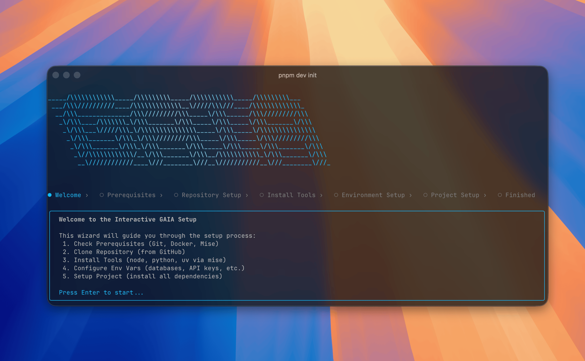

# @heygaia/cli



CLI tool for setting up and managing [GAIA](https://heygaia.io).

## Requirements

- **Node.js 20+** and one package manager (npm, pnpm, or bun)
- **macOS or Linux** (Windows via WSL2)
- **Docker** — `gaia up` offers to install it on apt-based Linux when missing
- **Git** installed

The CLI checks prerequisites at startup and reports what is missing.

## Installation

The standalone installer sets up Node.js if needed and installs the CLI:

```bash
curl -fsSL https://heygaia.io/install.sh | sh
gaia up
```

Or install globally with your preferred package manager:

```bash
npm install -g @heygaia/cli
pnpm add -g @heygaia/cli
bun add -g @heygaia/cli
```

## Commands

```bash
gaia up            # One-command self-host: configure, pull and start
gaia init          # Developer setup wizard (clone, configure, start)
gaia setup         # Configure existing repo
gaia start         # Start services in self-host mode
gaia dev           # Developer mode (Nx TUI)
gaia dev full      # Developer mode + workers (Nx TUI)
gaia logs          # Stream running logs
gaia stop          # Stop all services
gaia status        # Services and every dependency, with latency
gaia doctor        # Diagnose a GAIA install, with a fix per problem
gaia update        # Move to the GAIA release this CLI ships
gaia backup        # Dump MongoDB + PostgreSQL
gaia restore       # Restore those dumps
gaia --version     # Show CLI version
gaia --help        # Show all commands
```

### `gaia up`

One-command self-hosted setup: checks prerequisites (installing Docker on apt-based Linux with consent), clones GAIA to `~/gaia` if needed, writes the configuration, pulls the published images and starts the stack. GAIA is served on a single port (default 3000) through a bundled Caddy proxy.

| Flag | Description |
|------|-------------|
| `--yes` | No prompts; also consents to installing Docker |
| `--domain <domain>` | Serve at `https://<domain>` with an automatic certificate (ports 80 and 443) |
| `--web-port <port>` | Host port GAIA is served on (default 3000) |
| `--llm-provider <name>` | AI provider to save once GAIA is up, as the setup wizard would: `openrouter`, `gemini`, `openai`, `ollama` or `custom`. Not with `--no-start` |
| `--llm-key <key>` | API key for `openrouter`, `gemini`, `openai` and `custom` |
| `--llm-base-url <url>` | Endpoint for `ollama` (default `http://host.docker.internal:11434`) or `custom` (required) |
| `--llm-model <model>` | Model for `ollama` (optional) or `custom` (required) |
| `--code-sandbox` / `--no-code-sandbox` | Run agent code in local containers through the host Docker socket (root-equivalent; saved for later starts and updates) |
| `--build` | Build images from the checkout instead of pulling |
| `--no-start` | Configure only |

### `gaia update`

Moves the install to the GAIA release this CLI version ships: pulls its `v<version>` images (nothing changes if that fails), checks out the matching `cli-v<version>` compose files, pins `GAIA_VERSION` in `infra/docker/.env`, restarts, and prints what changed. Volumes and `.env` files are preserved.

| Flag | Description |
|------|-------------|
| `--yes` | Skip the confirmation |
| `--version <tag>` | Pin this image tag instead of the CLI's release |
| `--git` | Contributors: pull the current branch and rebuild the images from source |

### `gaia init`

The full interactive wizard, mainly for contributors (developer mode, Infisical). Self-hosters use `gaia up`.

| Flag | Description |
|------|-------------|
| `--branch <name>` | Clone a specific branch |

### `gaia setup`

Reconfigure an existing GAIA repo:

```bash
cd /path/to/gaia
gaia setup
```

### `gaia start`

Starts services for **self-host mode**.

```bash
gaia start
```

Optional flags:

- `--build` rebuild Docker images before starting
- `--pull` pull the images again before starting

### `gaia dev` / `gaia dev full`

Runs developer mode in foreground Nx TUI:

- `gaia dev` -> `mise dev`
- `gaia dev full` -> `mise dev:full`

### `gaia logs`

Streams logs for currently running services.

### `gaia stop`

Stops running GAIA services.

### `gaia status`

Shows health and latency for the services, plus every dependency the API reports at `GET /health/ready` (MongoDB, PostgreSQL, Redis, RabbitMQ, ChromaDB) with a fix for each failing one.

## Setup Modes

- **Self-Host (Docker)** — everything in Docker
- **Developer (Local)** — infra in Docker, app in local Nx TUI

## Port Overrides

When port conflicts are detected, overrides are written to `infra/docker/.env`. In self-host mode only the proxy port (`WEB_HOST_PORT`, plus `HTTPS_HOST_PORT` with a domain) is published.

## Development

```bash
# Build
cd packages/cli && pnpm run build

# Test the built CLI
./packages/cli/dist/index.js --help

# Run the test script
./packages/cli/test-cli.sh
```

## Publishing

1. Update version in `package.json`
2. Build: `pnpm run build`
3. Commit and tag: `git tag cli-v<version>`
4. Push tag — GitHub Actions publishes to npm

## License

MIT
